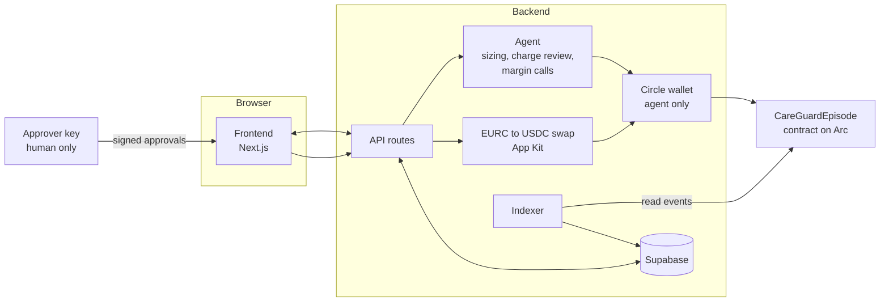

d# Architecture

Three parts: a **contract** that holds the money and enforces the rules, a **backend** where the agent decides and the API lives, and a **frontend** where people act. The contract is the source of truth for money; if the backend disappears, payers can still recover their funds through the contract.



---

## 1. Contract (owner: Clatson)

Solidity with Foundry, using OpenZeppelin's `EIP712`, `SignatureChecker`, `SafeERC20` and `ReentrancyGuard`. One contract holds all episodes.

### Storage

```solidity
enum Status { None, Created, Active, MarginCall, Closed, Expired }

struct Episode {
    address provider;
    address coverer;           // pays covered items
    address family;            // pays the rest
    uint256 guarantee;         // agent's sized amount, USDC (6 decimals)
    uint256 perChargeCap;
    uint64  expiresAt;
    uint256 covererBalance;
    uint256 familyBalance;
    uint256 paidTotal;
    Status  status;
}

IERC20  public immutable usdc;
address public immutable agent;
address public approver;

mapping(uint256 => Episode) public episodes;
mapping(bytes32 => bool)    public chargeUsed;   // blocks double payment
```

No arrays that grow with users.

### Functions

| Function | Caller | Checks | Effect |
|---|---|---|---|
| `createEpisode(provider, coverer, family, guarantee, perChargeCap, expiresAt)` | Agent | Non-zero addresses and amounts, expiry in the future | New episode, status Created |
| `fund(episodeId, amount)` | Coverer or family | Episode open, caller is a payer | `transferFrom` USDC; add to caller's balance |
| `payCharge(episodeId, chargeHash, amount, coveredAmount)` | Agent | Open, not expired, `amount <= perChargeCap`, `coveredAmount <= amount`, hash unused, balances enough | Deduct balances, mark hash used, send USDC to provider, status Active |
| `payChargeApproved(episodeId, chargeHash, amount, coveredAmount, deadline, sig)` | Agent | Same, but cap replaced by a valid approver signature before `deadline` | Same as `payCharge` |
| `raiseMarginCall(episodeId, payer, amount, reasonHash)` | Agent | Open | Status MarginCall, event only |
| `logDecision(episodeId, kind, decisionHash)` | Agent | Episode exists | Event only |
| `discharge(episodeId)` | Agent | Open | Return both balances to their payers, status Closed |
| `refundExpired(episodeId)` | Anyone | Open, `now >= expiresAt` | Same refund, status Expired |

A `fund` during MarginCall sets the status back to Active. Order in every function: **checks → effects → interactions**.

### Events

`EpisodeCreated`, `Funded(episodeId, payer, amount)`, `ChargePaid(episodeId, chargeHash, amount, coveredAmount)`, `MarginCall(episodeId, payer, amount, reasonHash)`, `DecisionLogged(episodeId, kind, decisionHash)`, `Refunded(episodeId, payer, amount)`, `EpisodeClosed`, `EpisodeExpired`.

They carry every ID and amount the UI needs.

### EIP-712 approval

```text
Domain:  name "CareGuard", version "1", chainId, verifyingContract
ApproveCharge(uint256 episodeId, bytes32 chargeHash, uint256 amount, uint256 coveredAmount, uint256 deadline)
```

The chain ID and contract address stop a testnet approval from working on mainnet. `chargeUsed` stops replay.

### Money units

USDC through its **ERC-20 interface, 6 decimals** (`0x3600000000000000000000000000000000000000` on Arc). EURC is never held by the contract; it's swapped first. The frontend uses `parseUnits(value, 6)` and `formatUnits(value, 6)`, and computes with `bigint` only.

---

## 2. Backend (owner: Clatson)

Next.js API routes plus a small agent module and an indexer, with Supabase. **The database caches money state; the contract is the truth.** Wiping the database and re-indexing events must rebuild balances and statuses.

| Service | What it does | Holds secrets? |
|---|---|---|
| **API** | Routes listed below; checks the caller's role | Supabase service key |
| **Agent** | Sizes guarantees, reviews charges, raises margin calls, discharges; writes a decision row with a plain-language reason before every onchain action | Agent wallet (Circle), LLM key |
| **Wallets** | Creates a Circle developer-controlled wallet per payer and provider | Circle API key, entity secret |
| **FX** | The payer converts EURC to USDC in their own wallet with App Kit's keyless swap (browser, `lib/client/fx.ts`); the agent verifies the swap receipt, compares what arrived with the quoted minimum and writes an `fx` decision with the rate and route | No (no API key in the browser) |
| **Indexer** | Reads contract events, updates Supabase | No |

### Currencies

The registry is `app/lib/currencies.ts`. Live on Arc today: **USDC** (pays directly) and **EURC** (converted with Circle App Kit swap, keyless path, signed by the payer's wallet). The local-currency stablecoins Circle has announced for Arc (JPYC, KRW1, BRLA, MXNB, QCAD, AUDF, PHPC, ZARU) have no Arc contract addresses yet; they show as "Coming to Arc" and can't be selected. When one launches, add its address and route there.

The pay form quotes the smallest EURC amount whose *guaranteed minimum* USDC output covers the share, converts it, then approves and funds USDC as usual. Anything above the share stays in the payer's wallet. If the price falls below the minimum the swap reverts and nothing is spent.

StableFX (Circle's RFQ FX on Arc, FxEscrow `0xd68256f4D69C6BbEcB873D8588AE0Dc6B8E22E10` on testnet) is the intended route for larger amounts and for the local currencies once they list, but it is permissioned (API access from Circle), so it is off.

### How the agent decides

Deterministic checks run first (cap, price list match, duplicate hash, balances); the LLM judges the rest (coverage split, unusual charges) and writes the reason. If the LLM and the checks disagree, the agent escalates. Every decision is stored with its inputs, outcome and reason, and its salted hash goes onchain.

### Database

```
providers     id, user_id, name, wallet_id, wallet_address
price_items   id, provider_id, code, label, unit_price_usdc        -- entered by the real provider
episodes      id, provider_id, contract_episode_id, quote_usdc, contingency_pct, guarantee_usdc,
              per_charge_cap, expires_at, status, is_internal_test
payers        id, episode_id, user_id, role (coverer|family), currency (USDC|EURC), wallet_id, wallet_address,
              owed_usdc, funded_usdc
charges       id, episode_id, price_item_id, description, amount_usdc, covered_usdc,
              status (paid|escalated|rejected|waiting), salt, hash, tx_hash
decisions     id, episode_id, kind (size|review|escalate|margin_call|discharge), inputs, outcome, reason,
              salt, hash, tx_hash, approver_verdict, created_at
transactions  id, episode_id, kind (fund|swap|charge|refund), payer_id, amount, currency, tx_hash, network
```

Row-level security: providers see their episodes and charges; payers see their episodes, charge amounts and categories, but never charge descriptions; the approver sees escalations.

### API

| Method | Path | Who | What it does |
|---|---|---|---|
| POST | `/api/price-list` | Provider | Save price items |
| POST | `/api/episodes` | Provider | Create from a quote; agent sizes the guarantee |
| GET | `/api/episodes/:id` | Parties | Episode, balances, charges, decisions |
| POST | `/api/episodes/:id/payers` | Provider | Add coverer and family payer |
| POST | `/api/episodes/:id/fund` | Payer | Fund in USDC or EURC |
| POST | `/api/episodes/:id/charges` | Provider | Submit a charge; agent decides |
| GET | `/api/approvals` | Approver | Escalated charges |
| POST | `/api/approvals/:chargeId` | Approver | Submit signed approval or rejection |
| POST | `/api/episodes/:id/discharge` | Provider | Close and refund |
| POST | `/api/episodes/:id/refund-expired` | Anyone | Trigger refund after expiry |
| GET | `/api/traction` | Team | Real counts and volumes, excluding internal tests |

Errors return `{ "error": "<what went wrong and how to fix it>" }`.

Rules:

- The **approver key never touches the server**.
- The agent wallet holds only what it needs for gas.
- Every job is safe to run twice.

---

## 3. Frontend (owner: Anto)

Next.js, Tailwind, Supabase auth and realtime. Everyone signs in with their own wallet (Sign-In with Ethereum, verified by Supabase) and chooses a role on first sign-in: hospital/clinic or patient/family. Payers approve and fund from their wallet in the browser (viem); the server verifies the `Funded` event in the receipt before recording it. The approver signs over-cap charges with the same wallet.

### Pages

| Page | Who | Key actions |
|---|---|---|
| `/` Landing | Everyone | What it is, how it works, sign in |
| `/provider/prices` | Provider | Enter and edit the price list |
| `/provider/episodes/new` | Provider | Enter quote, see the agent's guarantee and reason, add payers |
| `/provider/episodes/[id]` | Provider | Funding status, submit charge, charge list, discharge |
| `/pay/[id]` | Payer | Amount owed, fund (USDC/EURC), margin call, refund, "Refund after expiry" |
| `/approve` | Approver | Escalated charges, sign approve or reject |
| `/episodes/[id]/log` | All parties | Decision log with explorer links |
| `/team/traction` | Team | Numbers for the submission form |

### Rules for the frontend

- Show amounts as `125.00 USDC`; compute with `bigint` only.
- Always show which network you're on. On testnet, a persistent "Testnet: no real money" banner.
- Every transaction state is visible: pending → confirmed (with explorer link) → failed (with a plain reason).
- Before anything is signed, say in words what it does: "Approve charge #4: pay City Dental 320.00 USDC, 200.00 from the insurer and 120.00 from family."
- No sample or placeholder data. Empty states say what will appear and how to add the first item.
- Subscribe to realtime once per page.

---

## Repository layout

```text
careguard/
├── contracts/            # Foundry project (Clatson)
│   ├── src/CareGuardEpisode.sol
│   ├── test/             # unit, fuzz, invariant tests
│   └── script/Deploy.s.sol
├── app/                  # Next.js
│   ├── app/              # pages (Anto) and app/api routes (Clatson)
│   ├── lib/agent/        # sizing, review, margin call (Clatson)
│   ├── lib/circle.ts     # wallets and swap (Clatson)
│   ├── lib/chains.ts     # Arc testnet + mainnet (shared)
│   ├── lib/contract.ts   # address + ABI per network (shared)
│   └── lib/eip712.ts     # ApproveCharge type (shared contract!)
│   ├── lib/server/       # API services: chain writer, wallets, swap, db, auth (Clatson)
│   ├── jobs/indexer.ts   # (Clatson) lives in app/ to share the server code
├── supabase/migrations/  # (Clatson)
├── config/testnet.json, mainnet.json
└── docs/                 # these files
```

`lib/eip712.ts` and the contract's type string must match character for character. Agree on them tonight and change them only together.
