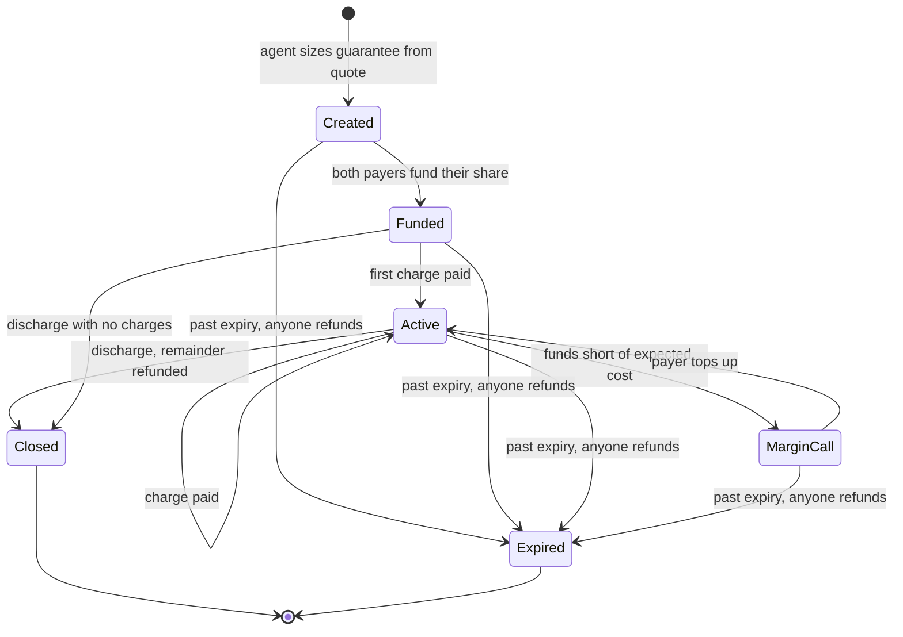
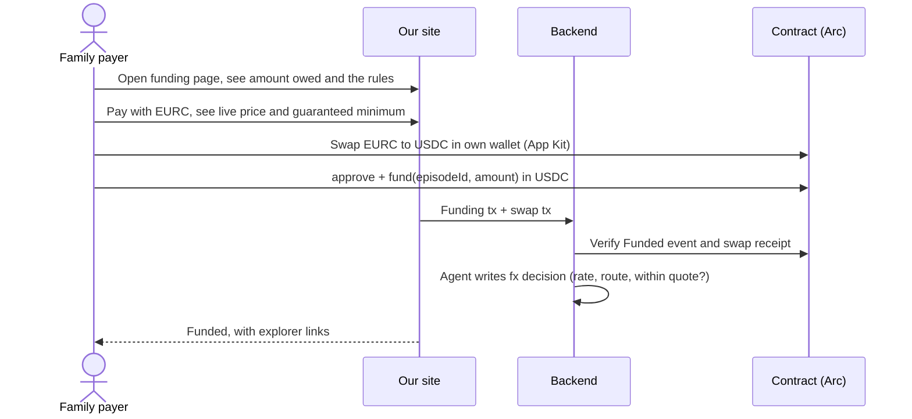
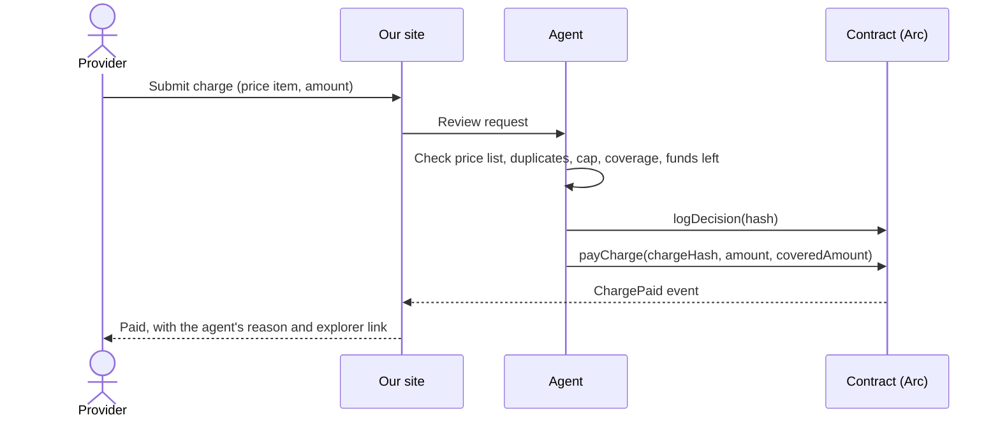

# Flow

How an episode moves from a quote to a refund, and who is allowed to do what at each step.

## The actors

| Actor | Who they are | What they hold |
|---|---|---|
| **Provider** | Clinic, dentist, hospital or facilitator | Their own wallet, which receives USDC; their price list |
| **Coverer** | Insurer, employer, or a relative paying covered items | Their own wallet with USDC on Arc |
| **Family payer** | Relative paying non-covered items, often in another country | Their own wallet with USDC on Arc (EURC to return later) |
| **Agent** | Our backend service | The agent wallet: creates episodes, pays charges, raises margin calls, discharges. Can't move money anywhere else |
| **Approver** | A human on our team | The approver key, which signs over-cap charges. Never on the server |
| **Contract** | Our smart contract on Arc | All episode money, with no private key |

## Episode lifecycle

Closed and Expired are final.

## Permissions

| Action | Who can do it | Money movement |
|---|---|---|
| Create an episode | Agent | None |
| Fund | The episode's coverer or family payer | Into that payer's balance in the episode |
| Pay a charge under the cap | Agent | From payer balances to the provider |
| Pay a charge over the cap | Agent, delivering the approver's signature | Same as above |
| Raise a margin call | Agent | None (event only) |
| Log a decision | Agent | None |
| Discharge | Agent | Each payer's remaining balance back to them |
| Refund after expiry | Anyone | Same as discharge |

---

## Flow 1: Provider sets up

1. Provider signs up and enters their **real price list** (code, label, unit price).
2. Provider creates an episode from a patient's quote and adds the two payers by wallet address.
3. Agent sizes the guarantee: quote total + contingency, and writes its reasoning to the decision log.
4. Agent calls `createEpisode(...)`; the contract emits `EpisodeCreated`.
5. Payers get a link to their funding page.

## Flow 2: Payers fund

The provider's page shows "Funds committed" once both payers have funded.

## Flow 3: Provider submits a charge

What the agent decides:

| Situation | Decision | Money |
|---|---|---|
| On price list, under cap, funds enough | Pay | Covered part from coverer, rest from family |
| Over cap, off the price list, or looks like a duplicate | Escalate | Nothing until the approver signs |
| Funds left < expected remaining cost | Margin call | Charge waits; payer asked to top up |

## Flow 4: Escalation

1. Charge appears in the approver's queue with the agent's reason.
2. Approver reads it and signs **Approve** or **Reject** (a typed message, no gas).
3. On Approve, the agent relays the signature with `payChargeApproved(...)`. On Reject, the charge is marked rejected and the provider is told why.

## Flow 5: Discharge

1. Provider clicks Discharge.
2. Agent logs the final reconciliation and calls `discharge(episodeId)`.
3. The contract returns each payer's remaining balance to them; `Refunded` events show the amounts.

## Flow 6: Our agent goes silent

1. The episode passes `expiresAt` without a discharge.
2. Any payer (or anyone) calls `refundExpired(episodeId)` from our site or the explorer.
3. The contract returns each payer's remaining balance.

Payers never depend on our server to get their money back.

## What can't happen, by design

- Nobody, including us, can send episode money anywhere except the provider or back to the payer who sent it.
- A charge can't be paid twice: each charge hash can be used once.
- The agent can't pay above the per-charge cap without the approver's signature, and the signature covers the episode, charge, amount, deadline, chain and contract.
- The agent can't spend one payer's money on the other's share.
